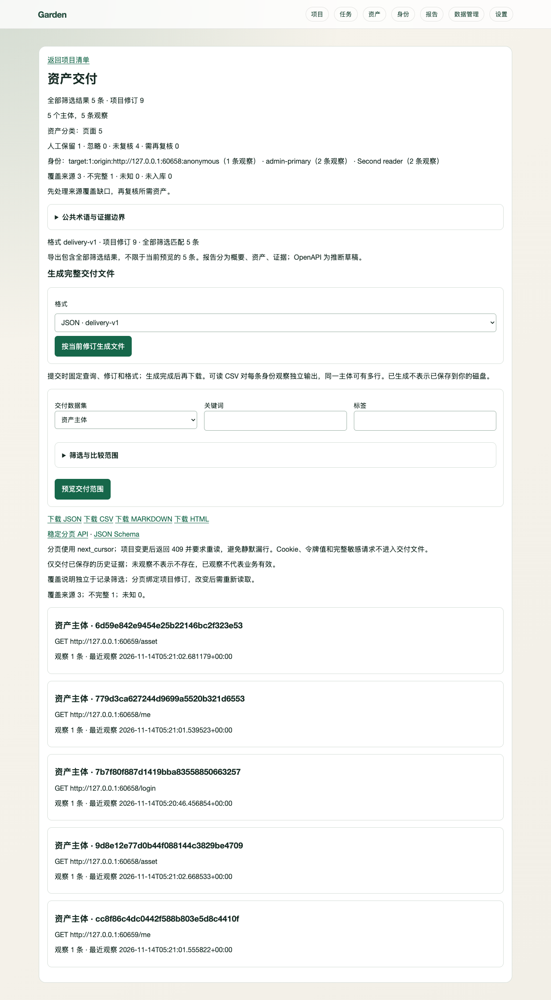

# Garden

> 从已授权入口发现资产，把匿名与登录态观察汇成可复核、可交付的清单。

[展示与使用文档](https://garden-ctl.com/) · [安装部署](docs/deployment.md) · [完整操作示例](docs/release-v2.md) · [最终验收报告](docs/quality/v2.0.0-acceptance-2026-11-14.md)

Garden 支持从一个 HTTP(S) URL 开始，也支持为项目绑定多个入口与身份。它保留页面、接口、资源、请求变体、来源和历史观察，再提供筛选、人工复核、变化比较与完整导出。CLI、WebUI、API 和 macOS App 共用现有 Python 引擎与项目数据。

```text
授权入口 → 匿名 / 身份采集 → 项目统一清单 → 人工复核 → 交付文件
                                  ↑                  ↓
                                  └── 显式周期复查 ──┘
```

## 当前状态

| 项目 | 已核实状态 |
| --- | --- |
| 源码版本 | **2.0.0**；G2-01—26 已完成实施与验收，止于发布准备 |
| 数据结构 | SQLite，迁移 head **0016**；历史观察与 delivery-v1 保留 |
| 核心运行环境 | Python **≥3.10**；最终 CI 验证 Linux Python 3.10 / 3.12 |
| 最终候选 | `8146a43`；两版各 **993 passed**，CLI smoke / Docker build 通过 |
| macOS App | **Apple Silicon / macOS ≥26.0 本地 Beta**，实测 26.3，捆绑 Python 3.12 与 Chromium |
| 正式发布 | **尚未发布**；未创建 tag / Release 或上传软件包；正式签名、公证与外部机器验证待完成 |

这里的测试数属于 [2026-11-14 最终候选 CI](https://github.com/Moxxkidd/Garden/actions/runs/43563921740)，文档更新不会将其改写为新代码的测试结果。[包清单与 SHA256](docs/quality/v2.0.0-packages.json)记录已验证的本地 wheel、sdist 和 DMG，当前没有公开发行包下载入口。

## 可以做什么

| 环节 | 当前能力 |
| --- | --- |
| 发现 | 快速 / 平衡 / 浏览器深入预设；HTML、Sitemap、JS 声明和显式导入线索；按路径族调度和有界采样 |
| 身份采集 | 登录状态导入与验证、人工完成验证码后恢复验证、显式人工浏览记录；入口与身份隔离 |
| 多入口 | 预览项目内多个入口/身份及固定配额，各子任务保持单 origin 范围，不借用预算 |
| 资产工作台 | 主体、请求变体、身份观察、候选与关系分开保留；模板展示、筛选、保存视图、批量复核与撤销 |
| 报告交付 | 概要 / 资产 / 证据三层报告，完整 JSON、机器/可读 CSV、Markdown、离线 HTML、PDF、ZIP 与推断 OpenAPI 草稿 |
| 后续管理 | 时效与变化比较、缺口补采、显式固定间隔复查、私有备份、空目录恢复与清理预览 |

浏览器深入混合模式面向**匿名单入口**；需要身份时使用独立身份采集或人工浏览流程。JS/OpenAPI 声明可能只是候选，未经请求不会变成已观察资产。模板只改变展示，人工保留不证明业务有效。

## 安装与第一次扫描

### 用户级 CLI

需要 Python 3.10+。在 macOS、Linux 或 WSL 中从仓库安装：

```bash
git clone https://github.com/Moxxkidd/Garden.git
cd Garden
./install.sh
garden --version
garden doctor
garden ui
```

安装器不使用 sudo。默认命令位于 `~/.local/bin`，运行环境位于 `~/.local/share/garden/runtime`，数据位于 `~/.garden`；按安装器提示配置 PATH。`gardenctl` 是兼容别名。安装器会备份并升级**所选数据目录**中的旧 SQLite 库，更新前先核对目录、停止原实例；`garden doctor` 本身只读，不连接扫描目标或执行修复。

登录、浏览器深入、人工浏览与 PDF 需要匹配的 Chromium。默认安装路径可执行：

```bash
~/.local/share/garden/runtime/venv/bin/python -m playwright install chromium
```

以下 8080 应是你已启动并授权的目标，8000 默认用于 Garden 本地界面：

```bash
garden scan http://127.0.0.1:8080/ --preset balanced
garden scan http://127.0.0.1:8080/ --preset deep --max-requests 50
garden scan http://127.0.0.1:8080/ --detach  # 仅提交，立即返回
```

首次扫描会启动或复用本机 Web 服务，并输出本次详情地址；`garden ui` 打开界面，`garden stop` 中断活动采集并停止本机服务。可通过 `GARDEN_HOME` 选择隔离数据目录；安装、CLI 与服务须使用同一目录。

### 源码开发与 Docker

```bash
python3 -m venv .venv
source .venv/bin/activate
make install
python -m playwright install chromium
cp .env.example .env
make dev
```

打开 [http://127.0.0.1:8000](http://127.0.0.1:8000)。`make demo` 也只是启动 Garden，不会另外启动示例业务站点。若只想本机试跑，可在另一个终端用 `python3 -m http.server 8080 --bind 127.0.0.1 --directory docs` 提供本仓库公开文档作为目标。

Docker 使用 `cp .env.example .env`、`docker compose up --build`；数据卷、容器网络和代理配置见[部署文档](docs/deployment.md)。容器里的 `127.0.0.1` 指向容器自身。

## 一条完整使用路径

1. **建立项目和入口**：在「项目」创建项目、绑定目标与精确入口；已有终态任务可以预览后导入。普通扫描也可独立使用。
2. **采集匿名或登录态资产**：匿名入口选择预设、预览范围与预算；需要登录时在「身份」打开独立浏览器，自行完成验证码，再显式确认并恢复验证。多入口计划逐项显示身份和配额。
3. **整理清单**：查看主体与身份观察，区分候选、已观察和缺口；按条件筛选、保存视图，填写理由后人工保留/忽略，必要时撤销。
4. **生成交付**：在「资产交付」查看三层摘要，按筛选与修订生成完整文件。公开交付脱敏；私有备份可能含会话秘密，不能用作公开报告。
5. **后续复查**：查看最后观察与变化。固定间隔计划默认关闭，预览并确认预算后才启用；仅在本地服务运行时执行，重启不补发。恢复只写入空目录，并暂停计划。



实际合成旅程已验证匿名、两入口两身份、人工复核、离线交付、周期复查和隔离恢复。[完整步骤与截图](docs/release-v2.md) · [合成结果](docs/examples/v2-journey.json)

常用交付与数据管理命令（项目 ID 与路径须替换为实际值）：

```bash
garden projects assets 1 --json
garden projects deliver 1 --format readable_csv --output assets-readable.csv
garden projects deliver 1 --format zip --output delivery.zip
garden projects freshness 1
garden projects schedules 1
garden storage usage
garden storage backup /absolute/path/to/empty-private-backup
garden storage restore /absolute/path/to/private-backup /absolute/path/to/empty-home
garden storage cleanup --retention-days 30  # 只预览
```

API 使用本地 `/docs` 与版本化 [delivery-v1](docs/asset-delivery-v1.md)；项目导出读取全部匹配项，不受屏幕页码限制。固定匿名/普通用户/管理员对照的 `garden coverage` 和既有高级 CLI 继续保留，见[认证演示](docs/demo-v06-identities.md)与[旧 CLI 迁移说明](docs/legacy-cli-migration.md)。

## 结果应该怎样读

- **执行完成 ≠ 覆盖完整**：100% 表示任务执行结束；身份失效、预算、超时和未请求线索仍可能留下缺口。
- **已观察 ≠ 业务有效**：同一路由可以保留多个请求变体和身份观察；候选、登录回退、软 404 等线索单独解释，人工保留只是人的选择。
- **未再观察到 ≠ 已删除或已修复**：范围、身份或覆盖不可比时保留未知，不补造旧记录缺失的预算与事实。
- **文件生成 ≠ 已保存**：Web 只确认生成和发起下载；App 选择保存位置并完成写入后才显示保存成功。

## 运行边界与验证范围

自动发现受同源、只读 GET、目标网络策略及请求/时间预算约束；人工浏览可能记录**用户实际触发的 POST**，不会进入自动重放。已授权公网和回环目标默认可用，RFC1918/ULA 内网还需显式配置 `GARDEN_ALLOW_PRIVATE_TARGETS=true`；每次连接与重定向重新校验地址。登录、验证、重定向和重试计入对应采集预算。

公开视图与导出默认脱敏；私有会话材料保留在受保护的本地引用后。只读诊断不等于连接测试，访问目标需显式运行 `garden connection-test URL`。权限、目标范围和固定身份语义不会因为加入项目而扩大。

最终候选已验证真实 v1.0 结构升级、Linux CI、macOS 26.3 arm64 实际安装与保存。固定合成语料的 3/3、3/3、0/20 不是实际站点完整性保证；WSL、Intel Mac、Windows 桌面、更早 macOS 和外部干净机器没有本轮验收证据。正式签名、公证、更新渠道和再分发许可仍需独立发布准备。

## 开发与文档

```bash
make lint
python -m ruff format --check .
python scripts/quality_baseline.py --full  # 一次全量，同时提取质量门禁
```

纯文档更新检查链接、JavaScript 语法和实际页面即可，不为同一候选重复运行全量。

- [操作、升级与备份恢复](docs/release-v2.md)
- [部署与代理](docs/deployment.md)
- [macOS App 使用、构建与发行限制](desktop/README.md)
- [质量定义与最终验收](docs/quality/README.md)
- [版本索引](docs/versions/README.md) · [历史功能沿革](docs/history.md)
- [架构](docs/architecture.md) · [威胁模型](docs/threat-model.md)

## 许可

项目元数据为 Proprietary，当前未声明开源许可证。复用或分发前请先联系仓库所有者。
