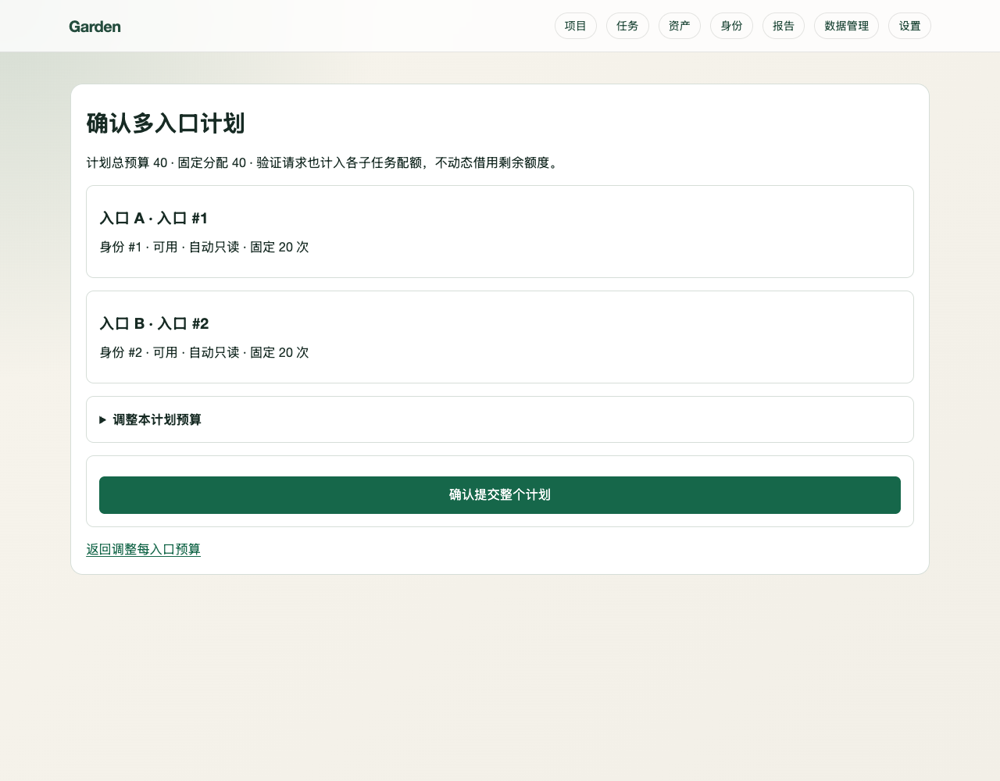
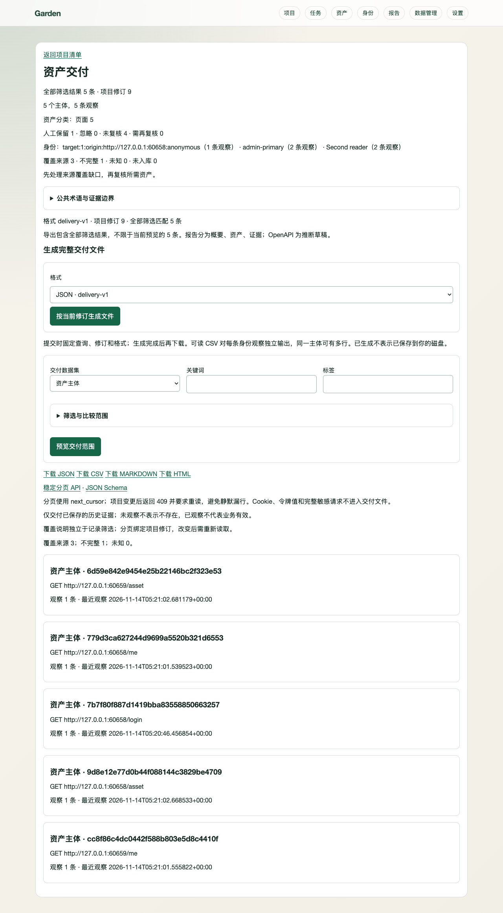

# Garden 2.0 操作与发布准备

当前功能冻结，版本 2.0.0、数据库 head 0016。正式发布尚未授权；没有 tag、GitHub Release 或已上传的发行包。最终候选 SHA、包摘要、CI 与逐项验收见 [v2.0.0 实施记录](versions/v2.0.0.md)。

## 三个真实入口

### 快速扫描

源码 / Python 安装仍使用 `garden` 或 `gardenctl`，核心支持 Python ≥3.10。使用明确的隔离数据目录开始合成演示；这里的 8080 应是你已经启动并授权的本机站点。

```bash
GARDEN_HOME=/absolute/path/to/demo-home garden --version
GARDEN_HOME=/absolute/path/to/demo-home garden scan http://127.0.0.1:8080/ --preset balanced
GARDEN_HOME=/absolute/path/to/demo-home garden ui
```

Web 首页输入 URL，预览实际参数、同源边界和预算，再确认开始。项目入口的「创建扫描」保留绑定；独立任务须导入匹配入口，不能把另一条入口路径的结果强行归入。

### 登录与多入口

在「身份」选择所属入口与身份资料，填写登录页、验证页及正向成功标记。打开独立 Chromium 后自行完成验证码、短信或扫码；点击「已完成登录，验证并保存」，Garden 关闭原上下文并用新上下文恢复验证。只有显示恢复验证通过后再预览采集。远程服务的窗口位于服务器，亦可显式导入状态。

项目「多入口 / 身份计划」分别选择身份和配额，预览后提交。一个 origin 一个子任务、身份互相隔离、不借用预算。跨站提示须另加入口。人工浏览模式会记录用户与浏览器实际产生的请求，可能包含 POST；自动模式不点击业务按钮或重放人工 POST。这里没有通用验证码绕过或厂商 SSO 承诺。



### 整理、交付与后续管理

项目清单支持核心、全部、候选、人工保留、忽略及需复核筛选。勾选明确 ID、填写理由，再保留或忽略；详情可撤销。旧标签不自动成为人工已复核，人工保留不证明业务有效。

在「资产交付」看概要、资产与证据，按当前筛选和修订生成完整文件。JSON 与机器 CSV 保留 delivery-v1；可读 CSV 按身份观察逐行。ZIP 包含清单、报告、schema、来源与范围/身份/预算；缺失的历史预算保持未知。PDF 使用 Chromium 与系统中文字体，其他格式不依赖 PDF 成功。

```bash
GARDEN_HOME=/absolute/path/to/demo-home garden projects deliver 1 --format readable_csv --output assets.csv
GARDEN_HOME=/absolute/path/to/demo-home garden projects deliver 1 --format zip --output delivery.zip
GARDEN_HOME=/absolute/path/to/demo-home garden projects freshness 1
```



执行完成 / 100% 不代表覆盖完整。查看身份、范围、预算及未覆盖说明；候选未请求、未知不等于不存在。文件已生成仅表示服务端就绪；Web 发起下载不证明用户保存，App 实际保存后才提示成功。

周期复查默认关闭，须预览固定间隔与每次预算并明确允许发送；仅在服务运行时执行，重启不补发，同项目活动则跳过，身份失效暂停。私有备份可能含会话秘密，不能作为公开交付包；恢复只写入选定空目录，计划暂停，不自动切换当前服务。

## 既有安装升级

先查看 `garden --version`、只读 `garden doctor` 和数据目录，停止旧版本持有的服务后再更换安装。备份数据库及引用文件；私有备份目录应妥善保管。显式运行 `garden db upgrade`，SQLite 修改前保留同目录 `.pre-upgrade-*.bak`。本候选实测从真实 v1.0 包生成的 0011 合成库升级至 0016；不会自动迁移用户日用库。

App 首次接入旧目录时，先只读检查，再明确勾选备份升级。不要用旧版本直接打开新 schema；需要恢复时选择已验证私有备份和新的空目录，备份后的修改不会保留。安装新包不会自动重启旧服务，版本不符会提示先处理原实例。

## 平台与发布限制

macOS App 是 **Apple Silicon / macOS ≥26.0 的本地 Beta**，实测宿主 26.3；捆绑 Python 3.12.14 与 Chromium 145。最低版本来自实际 Python/OpenSSL Mach-O 声明，不承诺更早 macOS、Intel Mac 或 Windows。

本候选使用临时 ad-hoc 签名，只能说明本地包完整性。Developer ID、hardened runtime / entitlements、公证与装订、正式更新密钥与渠道、Garden 独立许可证及依赖再分发条件、外部干净机器 / VM 仍需发布阶段独立核实。正式凭据使用和发行另需授权，不应关闭系统安全机制来解除提示。

固定语料指标和前版性能比较是合成实验；不外推为真实站点发现率或跨机器性能保证。[质量定义](quality/README.md)与[最终验收](versions/v2.0.0.md)分别说明历史与本候选证据。
